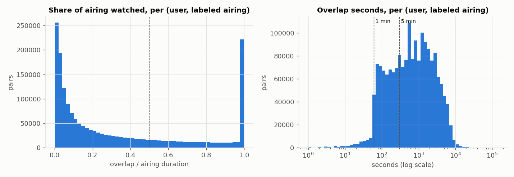

# sweet.tv TV Program Recommender

**Project report**

## 1. Title

| | |
|---|---|
| Name | Мухаметзянова Дильбар (Kaggle: @lildilya) |
| Course | Recommender Systems |
| Repository | https://github.com/mukhametzyanova27-coder/Recommender_systems_test_Mukhametzyanova |
| Kaggle competition | `sweettv-tv-program-recommender` |

Every number in this report comes from an actual run of the code in the repository, except the Kaggle scores,
which are taken from the Kaggle submissions page (Fig. 3). The source file in `outputs/` is given in parentheses
next to each table.

Notation: program titles are quoted exactly as they appear in the schedule (in Russian). Category names are
translated: Инфо → Info, Фильмы → Films, Сериалы → Series, Детям → Kids, Развлечения → Entertainment,
Познавательное → Educational, Другое → Other. Title prefixes in the data: «Т/с» = TV series,
«М/с» = animated series, «Х/ф» = feature film.

---

## 2. Problem statement and data

**Task.** For each of the 1,260 test users, predict 5 TV programs (`tv_show_id`) that the user will watch in
weeks 31–42 (2020-07-27 … 2020-10-18). The metric is MAP@5.

**Files** (sizes and row counts measured after download with `kagglehub`):

| File | Size, bytes | Rows (excl. header) | Content |
|---|---:|---:|---|
| `dataset11-30.csv` | 396,216,555 | 5,821,987 | viewing log: `user_id, vsetv_id, start_time, stop_time, duraton` |
| `export_arh_11-20-final.csv` | 153,322,643 | 1,074,235 | schedule, weeks 11–20 |
| `export_arh_21-30-final.csv` | 154,366,907 | 1,074,394 | schedule, weeks 21–30 |
| `export_arh_31-42-final.csv` | 185,952,991 | 1,295,378 | schedule, test weeks 31–42 |
| `submission.csv` | 38,348 | 1,260 | template: `user_id, tv_show_id` (5 space-separated ids) |

**Share of labeled airtime (`tv_show_id != 0`)** (`outputs/eda/schedule_files.csv`):

| Schedule | Channels | Rows with id | Airtime with id | Unique `tv_show_id` |
|---|---:|---:|---:|---:|
| weeks 11–20 | 400 | 10.76% | 15.97% | 5,847 |
| weeks 21–30 | 403 | 11.31% | 16.90% | 6,363 |
| weeks 31–42 | 404 | 11.18% | 16.67% | 6,636 |

**Data characteristics** (`outputs/eda/eda_report.md`):

* **Log.** 17 exact duplicates were removed, leaving 5,821,970 rows: 4,914 users, 202 channels (`vsetv_id`),
  2020-03-09 00:00:02 … 2020-07-26 23:59:58, i.e. ISO weeks 11–30. The shortest interval is 61 s, so the log
  contains only views longer than one minute. `duraton = stop_time − start_time` holds for 99.998% of rows.
  For 117 rows the difference is exactly 3,600 s: these intervals span the night of the daylight-saving switch
  on 2020-03-29. This shows that the log is recorded in local time with DST, like the schedule.
* **Schedule.** The files join up per channel with no gaps or overlaps: 99.988% of consecutive airings on a
  channel have neither. After concatenation one duplicate (channel, start) remains — a zero-length airing at the DST
  switch. Metadata within one `tv_show_id` is almost constant: the category never changes, genre 1 changes for 0.8%
  of programs and actors for 1.8%. Only the episode title changes.
* **Durations.** Median viewing interval 396 s, 75th percentile 1,452 s, 99th percentile 14,079 s (3.9 h),
  maximum 342,145 s (95 h). 2.2% of views are longer than 3 h and 0.37% longer than 6 h. Median labeled airing
  2,700 s (45 min), median over all airings 1,500 s. By category, the median labeled airing is 15 min for Kids,
  48 min for Series and 110 min for Films. Unlabeled airtime is noticeably shorter, with many 1–5-minute
  fillers and inserts (Fig. 1).
* **Uneven activity.** Weeks 11–20 have 4,220–4,721 active users per week. Weeks 21–26 have 2,406–3,572, and
  week 27 has only 105,223 views versus 232,680–465,317 in weeks 11–20 (`outputs/eda/log_weekly.csv`).
* **Test users.** All 1,260 appear in the log; 1,256 of them are active in weeks 11–20 and 1,246 in weeks 21–30.
  They are clearly more active than the other users (medians over weeks 11–30):

| Group | Users | Views | Hours | Active days |
|---|---:|---:|---:|---:|
| test users | 1,260 | 1,377 | 536.5 | 116 |
| other users | 3,654 | 733 | 340.1 | 94 |


---

## 3. Building interactions

### 3.1. Mapping `vsetv_id` to `channel_id` (verified)

* 197 of the 202 `vsetv_id` values match a `channel_id` in the schedule (the schedule has 405 channels). Five ids
  (149, 1174, 1508, 1509, 1510) do not appear in the schedule. They account for 1.95% of views and 1.35% of
  viewing time; there is nothing to match them to, so they are dropped.
* Under a direct id match, the most-watched channels get the names of the largest Ukrainian channels:
  3 = 1+1, 5 = ICTV, 7 = Новый канал, 6 = СТБ, 108 = Украина, 4 = Интер.
* **Statistical test** (`sweettv/channel_check.py`). If the mapping is correct, view starts and stops on channel X
  should cluster right after program starts in the schedule of X. Events are binned on a 5-minute grid. The
  expected number of events comes from a "date-hour activity × 5-minute-slot-of-hour effect" model. This removes
  both day-to-day changes in activity and the generic tendency to switch channels at :00/:30. For each log channel
  a z-score is computed against every one of the 404 schedule channels, allowing the schedule to be shifted by
  up to ±10 minutes.
  Result: the same-id channel is the best of 404 for 50 channels, which cover **76.6% of all events** among
  the tested channels. For the six largest channels z = 43–77, while the runner-up has z = 16–37. For the
  remaining channels the signal is at noise level (median best z = 3.6). The test is uninformative there, but it
  does not point to any other channel either.
* As a side finding, for TV1000 Action/TV1000/ViP Comedy CEE and Discovery the z-score peaks at a −5-minute shift,
  i.e. the actual broadcast starts about 5 minutes earlier than the schedule says
  (`outputs/eda/channel_shift_profile_top20.csv`). This was not corrected: with a "≥ 50% of the program"
  threshold, 5 minutes barely matter for long films.

**Decision:** the join uses `vsetv_id == channel_id`.

### 3.2. Join rule

A view matches an airing when the channel is the same and the intervals `[start_time, stop_time)` and
`[start, start + duration)` overlap. For each (user, airing) pair the overlaps of all views are summed
(`overlap_sec`), and `frac = min(overlap_sec / duration, 1)` is computed. Each period is joined separately, and
view intervals are cut at the period boundary so that seconds after a split point never reach training
(`sweettv/join.py`).

### 3.3. The "watched" threshold

Distributions over (user, labeled airing) pairs in weeks 11–20 (`outputs/join/`, Fig. 2):

* The watched share of an airing is bimodal: 28.3% of pairs have `frac` ≤ 0.05 (channel surfing) and 11.4% have
  exactly 1.0. Median 0.173, 75th percentile 0.58.
* The overlap in seconds has a median of 624 s. A "≥ 60 s" threshold removes almost nothing. A "≥ 300 s"
  threshold depends on program length, as the airing-length buckets show:

| Airing length | Pairs | share ≥ 50% of airing | share ≥ 300 s | share ≥ 60 s |
|---|---:|---:|---:|---:|
| ≤ 10 min | 94,087 | 78.8% | 69.1% | 95.1% |
| 10–30 min | 252,727 | 54.6% | 72.9% | 95.5% |
| 30–60 min | 314,058 | 34.3% | 68.3% | 96.3% |
| 1–2 h | 795,821 | 19.2% | 65.4% | 97.9% |
| > 2 h | 367,172 | 12.1% | 65.4% | 98.4% |

For films, "≥ 300 s" counts 62.5% of pairs as watched and "≥ 50%" counts 15.7%. In other words, with a
5-minute absolute threshold, flicking through a film already counts as "watching" it.



**Comparing three variants on validation.** Variants: `any60` (≥ 60 s), `abs300` (≥ 300 s), `frac50` (≥ 50% of
the airing). Training uses weeks 11–20 under one rule; the ground truth in weeks 21–30 uses another. Evaluation is
on test users, with repeats allowed. Reference models: popularity, CB with default settings and ALS with
preliminary parameters (`outputs/validation/A_threshold_rules.csv`):

| Training \ truth | any60: pop / CB / ALS | abs300: pop / CB / ALS | frac50: pop / CB / ALS |
|---|---|---|---|
| any60 | 0.806 / 0.056 / 0.795 | 0.738 / 0.044 / 0.720 | 0.551 / 0.021 / 0.499 |
| abs300 | 0.806 / 0.091 / 0.828 | 0.738 / 0.073 / 0.773 | 0.551 / 0.033 / 0.581 |
| **frac50** | 0.768 / 0.251 / 0.792 | 0.699 / 0.213 / 0.743 | **0.586 / 0.130 / 0.649** |
| mean truth size | 184.4 | 130.1 | 53.2 |

MAP values cannot be compared across columns: the broader the definition of "watched", the larger the truth set
and the higher the MAP.

**Choice: "watched" = at least 50% of the airing duration (`frac50`)**, for both training and ground truth.
Rationale:
* the threshold is equally meaningful for a 5-minute cartoon and a 2-hour film, and it falls in the valley of the
  bimodal distribution;
* with `frac50` truth, training on `frac50` is best for all three models. Mean MAP over the three models:
  0.455 versus 0.388 (`abs300`) and 0.357 (`any60`);
* CB trained on `frac50` is best in every column. ALS benefits from training on `abs300` only when the truth is
  defined more broadly.

### 3.4. `tv_show_id = 0`

Unlabeled airtime makes up 89% of schedule rows and 83–84% of airtime. It accounts for 49.5% of viewing time on
matched channels in weeks 11–20 and 41.7% in weeks 21–30 (`outputs/join/join_stats.json`). Id 0 covers many
different broadcasts rather than one program, so "0" cannot be recommended. **Decision:** these airings are not
items. They are excluded from the join output, interactions, the candidate pool, popularity and user profiles.
Time spent on them is not counted and is not redistributed to anything.

### 3.5. Interaction table

For each (user, `tv_show_id`) pair under `frac50` the table stores:

* `n_airings` — the number of watched airings;
* `watch_sec` — the total time on them;
* `last_start` — the time of the latest airing.

Size of the table (`outputs/join/interactions_by_rule.csv`):

| Period | (user, airing) pairs | (user, program) pairs | Users | Programs | Median programs per user |
|---|---:|---:|---:|---:|---:|
| validation training, weeks 11–20 | 517,124 | 199,627 | 4,789 | 2,705 | 36 |
| holdout, weeks 21–30 | 423,123 | 210,154 | 4,729 | 3,001 | 30 |
| final training, weeks 11–30 | 940,356 | 368,702 | 4,871 | 4,071 | 58 |

---

## 4. Evaluation protocol

* **Temporal split.** Training on weeks 11–20, holdout on weeks 21–30. A user's ground truth is the set of
  programs with an airing starting in weeks 21–30 that the user watched under `frac50`. The holdout is used only
  to choose rules, hyperparameters and hybrid weights, never for training. Final models are retrained on weeks
  11–30. The schedule of the target window is used only to know what is on air: it defines the candidate pool and
  supplies metadata of that window's programs for TF-IDF.
* **Who is evaluated.** The main set is the **1,244 test users** from the template who have a non-empty ground
  truth. The final metric is computed on these users, and they are clearly more active than the rest
  (Section 2). All tuning is done on them. The confirmation set is the **3,485 other users** with a non-empty
  ground truth; they took part in no choice at all. Users with an empty ground truth are excluded because AP is
  undefined for them. In validation, 11 of the 1,244 test users are cold: they have no `frac50` interactions in
  weeks 11–20.
* **Candidate pool** — the same for all methods: labeled `tv_show_id` values with at least one airing that
  starts in the target window. That is 6,376 programs for weeks 21–30 and 6,642 for weeks 31–42.
* **Repeats of already watched programs are allowed**, identically for all methods. On average 24.5% of a user's
  ground truth was already watched by that user in training, and forbidding repeats sharply hurts every method
  (`outputs/validation/B_repeats.csv`):

| Method (reference parameters) | Repeats allowed | Repeats forbidden |
|---|---:|---:|
| Popularity | 0.5863 | 0.1430 |
| Content-based | 0.1304 | 0.0347 |
| ALS | 0.6494 | 0.1828 |

* **Fallback for cold users** — the same everywhere: popularity, measured as the number of distinct users who
  watched the program in the last training week; ties are broken by popularity over the whole period. The window
  was chosen on validation: 1 week — 0.5863, 2 weeks — 0.5863 (same top 5), 4 weeks — 0.5645, whole period
  (10 weeks) — 0.5397 (file `C_popularity.csv` in `outputs/validation/`).
* **Exactly 5 unique ids** (`sweettv/recs.py::complete`). The model's ranking over the pool comes first, followed
  by the popularity fallback list. Duplicates are skipped and all ids come from the pool. A user the model cannot
  score (a cold user) gets the pure fallback. For every method we record how many users had all 5 slots filled by
  the model, some of them, or none (Section 6).
* **MAP@5 metric** (as in Kaggle / `ml_metrics`, `sweettv/metrics.py`):

$$\mathrm{AP@5}(u)=\frac{1}{\min(\lvert T_u\rvert,5)}\sum_{k=1}^{5}P@k(u)\cdot\mathrm{rel}_k(u),\qquad \mathrm{MAP@5}=\frac{1}{\lvert U\rvert}\sum_{u\in U}\mathrm{AP@5}(u)$$

  Here $T_u$ is the user's ground truth and $\mathrm{rel}_k(u)=1$ if the $k$-th recommendation is in $T_u$.
  We also report the standard error of the mean and a 95% confidence interval of the paired difference
  (bootstrap over users, 2,000 resamples, seed 42).

---

## 5. Methods

### 5.1. Popularity baseline (reference)

Popularity is the number of distinct users who watched the program (`frac50`) in the last training week, ranked
within the pool only. Because repeats are allowed, every user gets the same list.

### 5.2. Method 1. Content-based (TF-IDF)

* **Program vectors.** TF-IDF is built separately for each field: category; genres 1–3; year (decade and era
  tokens, plus an "ongoing/finished series" flag parsed from strings such as `2010-` and `1997-2007`); directors;
  actors (separators `,` and `/`). `sublinear_tf` is used. Each field is L2-normalized and multiplied by its
  field weight; the fields are concatenated and the vector is normalized again.
* **User profile** — a weighted sum of the vectors of watched programs. The weight is the number of airings
  (`count`), `log(1+count)`, `log(1+hours)` or 1, with exponential time decay (half-life in weeks).
  The score is the cosine between the profile and a program vector.
* **Tuning:** 160 configurations = 8 field-weight sets × 4 weighting schemes × 5 half-life options
  (none, 0.5, 1, 2, 4 weeks) (`outputs/validation/D_content_grid.csv`).
* **Best configuration:** weights (category, genre, year, director, actors) = (0.25, 0.25, 0.25, 2, 2), `count`
  weighting, half-life 1 week. MAP@5 = 0.3704; with default settings (all weights 1, `log_count`, no decay) it was
  0.1304.

### 5.3. Method 2. Matrix factorization: ALS for implicit feedback

* Library `implicit` 0.7.3, `implicit.cpu.als.AlternatingLeastSquares`. User × program matrix whose values are
  interaction weights (`count`, `log_count`, `log_hours`) with time decay. The `alpha` parameter scales confidence.
  The score is the dot product of the factors. Programs with no interactions in training cannot be scored and do
  not enter the model's ranking. If the model returned fewer than 5 candidates, the list would be completed from
  the fallback.
* **Tuning** (`outputs/validation/E_als_*.csv`): a coarse grid of 960 configurations — factors {32, 64, 128, 256}
  × regularization {1, 3, 10, 30, 100} × alpha {0.1, 0.3, 1, 3} × weighting {log_count, count, log_hours} ×
  half-life {none, 1, 2, 4}, 15 iterations each. Then a local refinement around the best point (108
  configurations: factors {64, 128, 256}, regularization {1.8, 3, 5.1}, alpha {0.01, 0.03, 0.1}, half-life
  {3, 4, 6, 8}), and the number of iterations {15, 30, 50} for the five best configurations (15 runs).
* **Best configuration:** factors = 64, regularization = 3, alpha = 0.1, iterations = 30, weighting = `count`,
  half-life 4 weeks. MAP@5 = 0.6580. The optima for alpha, regularization and half-life lie inside the refined
  grid.
* **Seed:** `random_state = 42`, `num_threads = 8`. Determinism was checked: two fits with the same parameters
  produce identical factors.

### 5.4. Hybrid of the two methods

Score fusion: $s = w\cdot\mathrm{norm}(s_{ALS}) + (1-w)\cdot\mathrm{norm}(s_{CB})$, where norm is a row-wise
min-max over the pool. Rank fusion (RRF, $1/(60+\mathrm{rank})$) was also tested for comparison.
Grid: 2 fusion types × $w \in \{0, 0.1, \dots, 1\}$ (`outputs/validation/F_hybrid_grid.csv`). Best variant:
**min-max, $w_{ALS} = 0.8$** (0.6597); $w = 0.9$ gives 0.6594 and $w = 1$ (pure ALS) gives 0.6580.
The best RRF is at $w = 1$ (0.6580). The selection rule was fixed in advance: the hybrid is chosen only if it
beats the best single method on both the test users and the confirmation users.

### 5.5. Seeds

`config.SEED = 42` is used for the ALS `random_state`, for `np.random.seed` in the validation script and for the
bootstrap generator. TF-IDF and popularity are deterministic.

---

## 6. Validation results

Training on weeks 11–20, holdout on weeks 21–30, `frac50` ground truth
(`outputs/validation/results.csv`, `outputs/RESULTS.md`). Cells contain MAP@5; "conf." = confirmation set:

| Method | Test (1,244) | Conf. (3,485) | All (4,729) | Δ vs baseline, test [95% CI] | Δ vs baseline, conf. [95% CI] |
|---|---:|---:|---:|---|---|
| Popularity baseline | 0.5863 ± 0.0094 | 0.4691 ± 0.0058 | 0.4999 | — | — |
| Method 1: Content-based | 0.3704 ± 0.0068 | 0.3077 ± 0.0042 | 0.3242 | −0.2159 [−0.2304; −0.2001] | −0.1614 [−0.1706; −0.1521] |
| Method 2: ALS | 0.6580 ± 0.0090 | 0.5382 ± 0.0058 | 0.5697 | +0.0717 [+0.0600; +0.0846] | +0.0690 [+0.0614; +0.0770] |
| **Hybrid ALS + CB** | **0.6597 ± 0.0090** | **0.5409 ± 0.0059** | **0.5721** | +0.0734 [+0.0620; +0.0856] | +0.0718 [+0.0642; +0.0796] |

± is the standard error of the mean over users.

**Hybrid vs ALS** (paired bootstrap, `outputs/validation/G_hybrid_vs_best_single.csv`): +0.0017
[−0.0026; +0.0060] on test users, not significant; +0.0027 [+0.0003; +0.0052] on confirmation users,
significant.

**Hyperparameters, run time and slot filling** (validation, 1,244 test users):

| Method | Hyperparameters | Fit, s | Predict, s | 5 slots from model | Fallback only |
|---|---|---:|---:|---:|---:|
| Popularity baseline | last 1 week | 0 | 0.005 | 0 | 1,244 |
| Content-based | fields (0.25, 0.25, 0.25, 2, 2), `count`, half-life 1 wk | 0.33 | 0.34 | 1,233 | 11 |
| ALS | f = 64, reg = 3, α = 0.1, 30 iterations, `count`, half-life 4 wk | 1.21 | 0.07 | 1,233 | 11 |
| Hybrid | min-max, $w_{ALS}$ = 0.8 | 1.54 (CB + ALS) | 0.49 | 1,233 | 11 |

No method produced a partially filled list (1 to 4 ids from the model). The 11 cold users got the pure fallback.
Fit time is one fit on weeks 11–20 (about 4.8 thousand users and 2.7 thousand programs). Predict time is
scoring 1,244 users against the 6,376-program pool plus building the lists. Measured on a shared machine
(128 CPUs); the values vary from run to run.

---

## 7. Final strategy and Kaggle

**Final strategy — the ALS + Content-based hybrid** (min-max score fusion, ALS weight 0.8). It is retrained on
weeks 11–30 with the hyperparameters chosen on validation; the candidates are the 6,642 programs of weeks 31–42.
Repeats are allowed, and the fallback is popularity in week 30.

The submitted file is `submission.csv` (`outputs/final/final_report.json`):

* 1,260 rows; columns and user order match the template;
* every user has exactly 5 unique non-zero ids, all from the weeks 31–42 pool;
* for 1,256 users all 5 recommendations come from the model; 4 users with no `frac50` interactions in weeks
  11–30 received the fallback;
* the submission contains 139 distinct programs in total;
* final fit time (latest run of `04_final.py`): CB 0.41 s, ALS 2.12 s;
* re-running `04_final.py` produced a byte-identical file.

The other methods' submissions are kept for comparison in `outputs/final/`:
`submission_popularity.csv`, `submission_content.csv` and `submission_als.csv`.

**Kaggle score.** The submission was made after the competition deadline; Kaggle marks it
"Complete (after deadline)".

| Submission | Private score | Public score |
|---|---:|---:|
| `submission.csv` (hybrid ALS + CB) | 0.40540 | 0.42619 |


The Kaggle scores are lower than the validation MAP@5 of the same strategy (0.6597 on test users, 0.5409 on
confirmation users). The numbers are not directly comparable: the rule Kaggle uses to build its ground truth is
unknown (Section 9.4), and the test window is 12 weeks long while the validation holdout is 10 weeks. Only this
one submission was scored on Kaggle, so the methods were not compared there.

---

## 8. Example users

These use the validation models trained on weeks 11–20, shown next to what the user actually watched in weeks
21–30 (`frac50`) and the user's history (`outputs/examples/examples.md`).

**User selection** — a deterministic activity rule among the 1,244 evaluated test users:

* **active:** 95th percentile of viewing hours in weeks 11–20;
* **low-activity:** 5th percentile of hours among users who have a history. Fully cold users (11 of them) are not
  shown: every method gives them the same fallback list, and their MAP@5 is identical (0.3048).

"In history" means the program was watched (`frac50`) in weeks 11–20; "Watched" means it is in the weeks 21–30
ground truth.

### 8.1. Active user `3916286176861764346`

History: 263.8 h, 94 programs. By category: Info 100.2 h, Films 92.4 h, Entertainment 31.4 h, Series 20.9 h,
Educational 16.9 h, Other 2.0 h. Ground truth: 141 programs. AP@5 = 1.0 for every method.

| Method | # | tv_show_id | Title | Category | In history | Watched |
|---|---|---|---|---|---|---|
| Popularity | 1 | 2400480 | ТСН. | Info | yes | yes |
|  | 2 | 240081 | Факты. | Info | yes | yes |
|  | 3 | 2400467 | 'Викна-Новости'. | Info | yes | yes |
|  | 4 | 2400508 | Сегодня. | Info | yes | yes |
|  | 5 | 20088 | 'Завтрак с 1+1'. Информационно-развлекательн… | Entertainment | yes | yes |
| Content-based | 1 | 2500261 | Подробности недели. | Info | — | yes |
|  | 2 | 240081 | Факты. | Info | yes | yes |
|  | 3 | 2400480 | ТСН. | Info | yes | yes |
|  | 4 | 5900347 | 'Деньги'. | Info | — | yes |
|  | 5 | 2400467 | 'Викна-Новости'. | Info | yes | yes |
| ALS | 1 | 2400480 | ТСН. | Info | yes | yes |
|  | 2 | 240081 | Факты. | Info | yes | yes |
|  | 3 | 2400467 | 'Викна-Новости'. | Info | yes | yes |
|  | 4 | 20088 | 'Завтрак с 1+1'. Информационно-развлекательн… | Entertainment | yes | yes |
|  | 5 | 200344 | 'Чистоnews'. | Entertainment | yes | yes |
| Hybrid | 1 | 2400480 | ТСН. | Info | yes | yes |
|  | 2 | 240081 | Факты. | Info | yes | yes |
|  | 3 | 2400467 | 'Викна-Новости'. | Info | yes | yes |
|  | 4 | 2400508 | Сегодня. | Info | yes | yes |
|  | 5 | 20088 | 'Завтрак с 1+1'. Информационно-развлекательн… | Entertainment | yes | yes |

What the user actually watched in weeks 21–30 (top 10 by hours):

| tv_show_id | Title | Category | Hours | Airings |
|---|---|---|---:|---:|
| 2400480 | ТСН. | Info | 27.74 | 32 |
| 200352 | 'Вечерний квартал'. | Entertainment | 22.95 | 12 |
| 6000483 | 'Свадьба вслепую', 6 сезон, 7 эп. | Entertainment | 19.35 | 9 |
| 6500479 | 'Мир наизнанку'. | Educational | 15.45 | 10 |
| 240081 | Факты. | Info | 11.88 | 33 |
| 700369 | 'Ліга сміху'. | Entertainment | 8.93 | 5 |
| 10002514 | Т/с 'Кухня'. | Series | 7.74 | 6 |
| 6700482 | Секретные материалы. | Other | 7.02 | 15 |
| 2400467 | 'Викна-Новости'. | Info | 6.56 | 11 |
| 300358 | Скетч-шоу 'На троих', 4 сезон. | Entertainment | 6.22 | 4 |

Top 5 of the history (weeks 11–20): Факты. (37.7 h), ТСН. (36.9 h), 'Викна-Новости'. (20.0 h),
'Завтрак с 1+1' (8.9 h), 'Мир наизнанку' (8.5 h).

Every method gets 5 out of 5, because the news programs this user watches regularly keep being broadcast.
Content-based added two programs that were not in the history ('Подробности недели', 'Деньги'), both news, and
both are in the ground truth.

### 8.2. Low-activity user `17676810254267048747`

History: 16.0 h, 18 programs. By category: Kids 8.2 h, Entertainment 2.9 h, Series 2.1 h, Educational 1.5 h,
Info 1.3 h. Ground truth: 28 programs. AP@5: Popularity 0.28, Content-based 0.40, ALS 0.40, hybrid 0.52.

| Method | # | tv_show_id | Title | Category | In history | Watched |
|---|---|---|---|---|---|---|
| Popularity | 1 | 2400480 | ТСН. | Info | yes | yes |
|  | 2 | 240081 | Факты. | Info | — | — |
|  | 3 | 2400467 | 'Викна-Новости'. | Info | — | — |
|  | 4 | 2400508 | Сегодня. | Info | — | — |
|  | 5 | 20088 | 'Завтрак с 1+1'. Информационно-развлекательн… | Entertainment | — | yes |
| Content-based | 1 | 12002955 | М/с 'Свинка Пеппа'. | Kids | yes | yes |
|  | 2 | 12002172 | М/с 'Гуппи и пузырики', 1 сезон, 8 с. 'Щенок… | Kids | yes | yes |
|  | 3 | 12002856 | М/с 'Элвиннн!!! и бурундуки'. | Kids | yes | — |
|  | 4 | 700389 | Кто сверху? | Entertainment | yes | — |
|  | 5 | 400426 | 'Меняю жену'. | Entertainment | — | — |
| ALS | 1 | 12002955 | М/с 'Свинка Пеппа'. | Kids | yes | yes |
|  | 2 | 12002896 | М/с 'Вспыш и чудо-машинки', 2 сезон, 14 с. '… | Kids | yes | yes |
|  | 3 | 12002201 | М/с 'Маша и Медведь'. | Kids | yes | — |
|  | 4 | 12002805 | М/с 'Моланг'. | Kids | yes | — |
|  | 5 | 12002856 | М/с 'Элвиннн!!! и бурундуки'. | Kids | yes | — |
| Hybrid | 1 | 12002955 | М/с 'Свинка Пеппа'. | Kids | yes | yes |
|  | 2 | 12002896 | М/с 'Вспыш и чудо-машинки', 2 сезон, 14 с. '… | Kids | yes | yes |
|  | 3 | 12002856 | М/с 'Элвиннн!!! и бурундуки'. | Kids | yes | — |
|  | 4 | 12002201 | М/с 'Маша и Медведь'. | Kids | yes | — |
|  | 5 | 12002172 | М/с 'Гуппи и пузырики', 1 сезон, 8 с. 'Щенок… | Kids | yes | yes |

What the user actually watched in weeks 21–30 (top 10 by hours):

| tv_show_id | Title | Category | Hours | Airings |
|---|---|---|---:|---:|
| 10002787 | Т/с 'Любовь по закону', 1-4 с. | Series | 4.23 | 2 |
| 12002896 | М/с 'Вспыш и чудо-машинки', 2 сезон, 14 с. '… | Kids | 3.18 | 9 |
| 90048095 | Премьера. Х/ф 'Список Шиндлера'. | Films | 3.08 | 1 |
| 400468 | Аферисты в сетях, 5 сезон, 1 эп. | Educational | 2.71 | 3 |
| 90075346 | Х/ф 'Отверженные'. | Films | 2.53 | 1 |
| 90031615 | Х/ф 'Побег из Шоушенка'. | Films | 2.33 | 1 |
| 90065425 | Х/ф 'Спасатель'. | Films | 2.25 | 1 |
| 90074962 | Х/ф 'Эволюция Борна'. | Films | 2.25 | 1 |
| 90052398 | Х/ф 'Сладкая жизнь'. | Films | 2.16 | 1 |
| 90081568 | Х/ф 'Игра на понижение'. | Films | 2.08 | 1 |

Top 5 of the history (weeks 11–20): 'Кто сверху?' (2.7 h), Т/с 'Великолепный век' (1.8 h),
М/с 'Гуппи и пузырики' (1.7 h), 'Удачный проект' (1.5 h), М/с 'Свинка Пеппа' (1.5 h, 17 airings).

Popularity suggested news that this user hardly watches. The personalized methods rely on the animated series in
the history. The hybrid gets 3 out of 5 and each single method 2 out of 5. At the same time, 7 of the top 10
actual views are films, each watched in a single airing, and no method suggested any of them.

---

## 9. Business and algorithmic analysis: which strategy should sweet.tv choose, and why?

The additional calculations for this section were done by `scripts/07_analysis.py` on the same validation data
(1,244 test users, models trained on weeks 11–20). Results are in `outputs/analysis/`.

### 9.1. Familiar preferences or new programs?

A "familiar" program is one the user watched (`frac50`) in weeks 11–20; a "new" one was not watched under that
rule. This does not mean the user has never seen it: the log reflects only views on this platform that are longer
than 60 s, and the `frac50` threshold excludes partial views.

| Method | Familiar slots | Hit rate, familiar | New slots | Hit rate, new | New hits, total |
|---|---:|---:|---:|---:|---:|
| Popularity | 74.3% | 75.8% | 25.7% | 27.1% | 433 |
| Content-based | 57.7% | 70.7% | 42.3% | 10.7% | 281 |
| ALS | 96.6% | 71.4% | 3.4% | 18.4% | 39 |
| Hybrid | 96.6% | 71.3% | 3.4% | 20.1% | 42 |

* The ALS and hybrid lists consist almost entirely of **familiar** programs. In the final submission for weeks
  31–42, 97.6% of the hybrid's slots are programs already watched in weeks 11–30 (popularity 80.7%, CB 63.6%,
  ALS 97.9%). This is consistent with the data: allowing repeats raised MAP 3.5–4.1-fold (Section 4), and
  regular programs are re-broadcast often. Over the 10 holdout weeks, the median number of airings per pool program
  is 98 for Info, 24 for Series and 7 for Kids (`airings_in_holdout_window_by_category.csv`).
* At the same time, on average 75.5% of a user's ground truth consists of programs the user did not watch in
  training (24.5% were already watched). 29.1% of ground-truth pairs fall on programs that had no interactions
  from any user in weeks 11–20. The room for "discovery" is large, but it is hard to hit.
* A new program is not automatically a successful discovery. 42% of CB's slots are new, but only 10.7% of them
  are in the ground truth. That is lower than for popularity's new slots (27.1%), where "new" means nationwide news.
  CB finds the most new hits in absolute terms (281), but at the cost of precision: its MAP@5 is 0.370 versus 0.586
  for the baseline. A good example of CB novelty is the active user in Section 8: two new news programs, both in
  the ground truth.

### 9.2. How and why the methods differ

**MAP@5 by user activity in training** (number of programs watched in weeks 11–20):

| Programs in history | Users | Popularity | Content-based | ALS | Hybrid |
|---|---:|---:|---:|---:|---:|
| 0 (cold) | 11 | 0.3048 | 0.3048 | 0.3048 | 0.3048 |
| 1–10 | 46 | **0.3045** | 0.1888 | 0.2873 | 0.2889 |
| 11–30 | 301 | 0.4159 | 0.2782 | **0.4906** | 0.4903 |
| 31–60 | 522 | 0.6018 | 0.3796 | 0.6846 | **0.6868** |
| > 60 | 364 | 0.7491 | 0.4583 | 0.8158 | **0.8184** |

**Coverage and concentration** (validation, `coverage_validation.csv`):

| Method | Distinct ids recommended | Slots from top-10 popular | Users with the same list as popularity | Users with AP@5 = 0 |
|---|---:|---:|---:|---:|
| Popularity | 5 | 100% | 100% | 7.2% |
| Content-based | 392 | 40.0% | 0.9% | 9.3% |
| ALS | 90 | 74.2% | 1.5% | 4.5% |
| Hybrid | 138 | 74.6% | 3.0% | 4.6% |

* **Where the baseline is already good.** A few news programs are watched by most users. In the last training
  week ТСН was watched by 1,526 users and Факты by 1,278. In the holdout, ТСН is in the ground truth of 77.6% of
  test users and Факты of 77.7% (`popularity_top5_validation.csv`). This is why one news list for everyone
  already scores 0.586. For cold users all methods coincide with popularity. In the group with 1–10 programs in
  history (46 users), popularity was the best: 0.305 versus 0.289 for the hybrid. The group is small and the
  significance of this difference was not tested separately.
* **What MF (ALS) captures.** ALS combines overall popularity with the user's own repeat viewing and with
  co-viewing patterns. Its best parameters are regularization 3, a small alpha (0.1) and count weights with a
  4-week half-life; larger alpha values in the grid gave worse results. It beats popularity in every group from
  11 programs of history upward: +0.075 (11–30), +0.083 (31–60), +0.067 (> 60). The limitation of ALS is that it
  cannot score programs with no interactions in training. That is 4,355 of the 6,376 pool programs (only 2,021
  have interactions), and they account for 29.1% of ground-truth pairs.
* **What content attributes add where co-viewing signal is scarce.** CB can score any pool program, including
  programs with no interactions. Metadata is almost always unique: a fully identical set of attributes occurs for
  10.5% of Info programs in the pool and under 7% in the other categories. However, directors and actors are
  missing in 13.5% and 13.1% of labeled rows, and attribute similarity does not tell whether the user will watch a
  particular film in a particular airing. In the 1–10 programs group CB is below popularity (0.189 versus
  0.305), so on these data the attributes do not make up for a weak co-viewing signal. For films, which account
  for 59.8% of ground-truth pairs, the hit rate of CB's film recommendations is 3.1%. CB's useful contribution to
  the hybrid is to lift the user's specific recently watched programs (1-week half-life, high director and actor
  weights). This gives +0.0027 MAP on the confirmation users and, for example, the third hit for the low-activity
  user in Section 8.

### 9.3. Why the hybrid is preferable

* **Metric.** The hybrid is the best on both sets: 0.6597 (test) and 0.5409 (confirmation), versus 0.6580 and
  0.5382 for ALS and 0.5863 and 0.4691 for popularity. Its gain over the baseline (+0.073) is significant on both
  sets. Its gain over ALS is small: not significant on test users, significant on confirmation users
  (+0.0027 [+0.0003; +0.0052]).
* **Computational cost at this scale** is negligible. Final training covers 4,871 users and 4,071 programs with
  interactions, with a 6,642-program pool. Fitting CB takes 0.3–0.4 s and ALS 1.2–2.1 s; scoring 1,244 users
  against the whole pool takes 0.49 s for the hybrid. Most of the full pipeline's time goes into hyperparameter
  search (1,000 of 1,254 s) and the channel check in EDA, not into the models themselves (Section 10). The hybrid
  requires maintaining two models, but both are cheap.
* **User experience.** The hybrid's lists are personalized: only 3.0% of users get the same list as popularity.
  They are more diverse than ALS's (138 distinct programs versus 90) and, as Section 8 shows, reflect the specifics
  of a household, such as children's content. News still dominates the top 5: 58.8% of the hybrid's slots are
  Info. This reflects real regular viewing but makes the feed narrow.
* **Recommendation for sweet.tv** (within the validated data): use the ALS + CB hybrid as the main source of
  personal recommendations and popularity for cold users. If simplicity of maintenance matters, ALS is almost as
  good (−0.002 MAP@5). A separate "new for you" block should be built with care on these data: new recommendations
  hit much less often than familiar ones for every method (10.7–27.1% versus 70.7–75.8%).

### 9.4. Limitations and failure cases

* **Only about 10.8–11.3% of schedule rows** (16.0–16.9% of airtime) have a `tv_show_id`. Unlabeled airtime
  accounts for 42–50% of viewing time, and preferences in that part are completely invisible to the models.
* **Films.** 59.8% of ground-truth pairs are films. Films make up 5,343 of the 6,376 pool programs in weeks 21–30;
  their median is 3 airings in 10 weeks, and 21.2% are aired only once. The hybrid gives films 0.8% of its slots,
  with a 4.2% hit rate; ALS gives them only 3 slots out of 6,220. Users with AP@5 = 0 under the hybrid (57 users,
  4.6%) differ from the rest: smaller ground truth (median 11 versus 41 programs), shorter history (median 18
  versus 46 programs) and a larger share of films in the ground truth (65.2% versus 51.7%).
* **Cold and low-activity users.** 11 cold users in validation and 4 in the final submission receive only
  popularity. For users with 1–10 programs in history, the personalized methods did not beat the baseline.
* **Popularity bias.** 74.6% of the hybrid's slots are programs from the top 10 by popularity. Info makes up
  58.8% of the hybrid's slots but only 7.2% of ground-truth pairs. High precision on news offsets this in MAP@5,
  but not in diversity.
* **Data and labeling.** Five channels without a schedule (1.95% of views) were dropped. The ~5-minute schedule
  offset on some film channels was not corrected. Very long sessions (up to 95 h, probably a TV left on) were not
  filtered and may produce false `frac50` views. Activity in the log is noticeably lower in weeks 21–27, so the
  holdout may be atypical.
* **Evaluation.** The rule Kaggle uses to build its ground truth is unknown. The MAP level depends strongly on the
  definition of "watched": 0.586 for popularity with `frac50` versus 0.806 with `any60`. On Kaggle the hybrid
  scored 0.42619 (public) and 0.40540 (private), below its validation MAP@5 of 0.6597, so the absolute validation
  level does not carry over to the leaderboard. Hyperparameters were tuned
  on the same 1,244 users, so the estimate on them is optimistic; the confirmation set gives a fairer one. No A/B
  tests were run, and no conclusions about effects on user behavior or business metrics can be drawn from these
  data.

---

## 10. Environment and reproducibility

* **Environment** (`outputs/environment.json`): Python 3.10.14, Linux 6.8.0-83-generic x86_64, 128 CPUs,
  OpenBLAS 0.3.29.
* **Library versions** (`requirements.txt`): numpy 2.2.6, pandas 2.3.3, scipy 1.15.3, scikit-learn 1.7.2,
  implicit 0.7.3, kagglehub 1.0.2, pyarrow 25.0.1, matplotlib 3.10.9, tabulate 0.10.0, threadpoolctl 3.7.0.
* **Seeds and threads:** `SEED = 42` (ALS `random_state`, bootstrap, `np.random.seed`); ALS `num_threads = 8`;
  `OPENBLAS_NUM_THREADS = 1` in scripts 03 and 04.
* **Run time.** The whole pipeline was re-run from scratch into an empty results folder, with data from the
  kagglehub cache (`outputs/runtime_clean_run.txt`). The machine is shared: load average was 141–179 across three
  readings on 128 CPUs, so the timings are approximate.

| Step | Time, s |
|---|---:|
| `01_eda.py` (including the channel check) | 115.1 |
| `02_join.py` | 37.7 |
| `03_validate.py` (grids: CB 160, ALS 960 + 108 + 15, hybrid 22) | 999.9 |
| `04_final.py` | 27.5 |
| `05_examples.py` | 19.5 |
| `06_report.py` | 0.6 |
| `07_analysis.py` | 53.2 |
| **Total** | **1,253.5 (≈ 21 min)** |

* **Reproducibility.** The clean run was compared with the main run. `submission.csv` and the submissions of all
  four methods matched byte for byte, as did `best_config.json`. In all tuning tables (A–G and `results.csv`), every
  MAP@5, standard-error and confidence-interval column matched; only the timing columns differ. EDA, examples
  and analysis matched byte for byte.
* **How to run.** Clone the repository (link in Section 1), then from its root:
  ```bash
  python -m venv .venv && .venv/bin/pip install -r requirements.txt
  # optional; without it the data is downloaded by kagglehub:
  export SWEETTV_DATA_DIR=/path/to/data
  # steps 01-07; result: ./submission.csv
  PYTHON=.venv/bin/python ./run_all.sh
  ```

---

## 11. Disclosure

* **Libraries:** numpy, pandas, scipy (sparse matrices), scikit-learn (`TfidfVectorizer`, `normalize`),
  implicit (`AlternatingLeastSquares`), kagglehub (data download), pyarrow (parquet cache), matplotlib (plots),
  tabulate (Markdown tables), threadpoolctl (BLAS information).
* **External code:** no third-party code was copied. MAP@K is implemented from the definition used by Kaggle and
  by the `ml_metrics` package; the package itself was not used.
* **AI assistant:** the work was done with the help of the AI assistant Claude Code (Anthropic). The assistant
  wrote the code, ran the experiments and drafted this report. The session export is attached.
